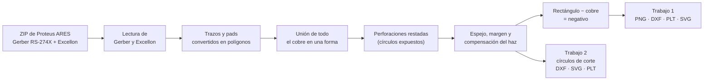

# Proteus → Láser

**De Gerber a láser: el negativo del cobre y las perforaciones de una PCB casera, listos para RDWorks.**

Herramienta gratuita que convierte lo que entrega **Proteus ARES** (Gerber RS-274X + taladros Excellon) en los archivos que necesita una cortadora láser para fabricar una placa con el método del *sticker + cloruro férrico*. Funciona **directamente en el navegador**: no hay que instalar nada y tus archivos nunca salen de tu equipo.

**Probar la herramienta:** https://thecrisxd.github.io/Gerber-to-RDworks/

---

## Tabla de contenidos

1. [Qué hace](#qué-hace)
2. [Cómo funciona](#cómo-funciona)
3. [Para qué se hizo: el problema real del taller](#para-qué-se-hizo-el-problema-real-del-taller)
4. [Uso](#uso)
5. [Exportar los archivos desde Proteus ARES](#exportar-los-archivos-desde-proteus-ares)
6. [Archivos que genera](#archivos-que-genera)
7. [Flujo completo en la máquina](#flujo-completo-en-la-máquina)
8. [Opciones](#opciones)
9. [Pruebas realizadas y límites conocidos](#pruebas-realizadas-y-límites-conocidos)
10. [Seguridad](#seguridad)
11. [Estructura del repositorio](#estructura-del-repositorio)
12. [Publicar tu propia copia con GitHub Pages](#publicar-tu-propia-copia-con-github-pages)
13. [Licencia y autoría](#licencia-y-autoría)

---

## Qué hace

Recibe el **ZIP de Gerber de Proteus ARES** (o cada archivo por separado) y entrega dos trabajos que comparten el mismo origen, la misma orientación y el mismo tamaño:

| Trabajo | Qué contiene | Para qué modo del láser |
|---|---|---|
| **1. Negativo del cobre** | Un rectángulo que cubre la placa con «huecos» donde van las pistas y los pads. Las perforaciones quedan como círculos expuestos dentro de cada pad. | **Scan**: el láser retira el sticker solo donde *no* debe quedar cobre. |
| **2. Perforaciones** | Los contornos de los agujeros (círculos reales en rojo). | **Cut**: se cortan los agujeros después del ácido, cuando ya no hay cobre encima. |

Cada trabajo se entrega en varios formatos (PNG, DXF, PLT, SVG) y todo en **milímetros, con origen en 0,0**. La página además muestra el **tamaño real** del trabajo para comprobarlo en el software del láser.

## Cómo funciona



1. **Lectura.** Un intérprete propio de Gerber RS-274X (aperturas circulares, rectangulares, ovales, poligonales y macros; trazos con arcos; regiones; polaridad clara/oscura) y de Excellon. El formato del archivo de taladros (unidades, ceros, dígitos) se **detecta solo**, comparando las posiciones con el cobre.
2. **Geometría.** Cada pista (un trazo con grosor) y cada pad se convierte en un polígono real con [Shapely](https://shapely.readthedocs.io/); todo se une en una sola forma de cobre y se resta de un rectángulo con margen. Es justo la operación que un editor vectorial no logra cuando hay cientos de trazos.
3. **Ajustes.** Espejo horizontal, margen, compensación del haz y limpieza (se cierran rendijas numéricas, se descartan motas, se simplifican vértices sin afectar la precisión).
4. **Perforaciones.** Los taladros del Excellon se restan del cobre: cada uno queda como un círculo expuesto dentro de su pad. La herramienta verifica que todos aparezcan en el resultado.
5. **Salidas.** PNG a escala real (Pillow), DXF R12, PLT (HPGL) y SVG. En la web también se genera un ZIP con todo.

**Versión web.** El mismo programa de Python corre dentro del navegador gracias a [Pyodide](https://pyodide.org/) (Python compilado a WebAssembly), dentro de un *Web Worker* para que la página no se congele. No hay servidor: GitHub Pages solo entrega los archivos.

**Tecnologías:** Python · Shapely · Pillow · NumPy · Pyodide / WebAssembly · HTML + JavaScript · GitHub Pages.

## Para qué se hizo: el problema real del taller

El método de fabricación que resuelve es este:

1. Se pega un **sticker** sobre la placa de cobre.
2. El **láser CO₂ (modo Scan)** retira el sticker solo en las zonas donde *no* debe quedar cobre.
3. El **cloruro férrico** ataca el cobre expuesto; las pistas y los pads, protegidos por el sticker, se conservan.
4. Con el cobre ya retirado en el centro de cada pad, el láser vuelve a pasar y **corta las perforaciones** (el cobre refleja el haz del CO₂; sin cobre el corte es limpio).
5. Se montan los componentes y se sueldan.

Para que eso funcione hacían falta varias cosas que ninguna herramienta resolvía junta. Cada decisión de diseño responde a un problema concreto:

| Problema que apareció | Qué hace la herramienta |
|---|---|
| Al abrir el PDF/SVG de ARES en un editor vectorial, convertir los trazos a trayectos y unirlos **se bloqueaba con cientos de trayectos** (más de 689 en la placa de prueba). | Hace la conversión y la unión con geometría computacional, en segundos, sin importar cuántos trazos haya. |
| RDWorks recibía **líneas con grosor** y las mostraba como trayectos (las «flechas rojas») en vez de un dibujo de la placa; en modo Scan solo se rellenan áreas. | Entrega una **imagen en blanco y negro a escala real**: negro puro que ocupa el espacio real de cada trazo, conservando las proporciones. |
| El láser debe quitar el sticker **donde no hay cobre**, no donde sí. | Genera el **negativo**: lo que se graba es el fondo; pistas y pads quedan protegidos. También permite elegir el modo contrario (positivo). |
| El láser trabaja sobre la cara de cobre, vista desde abajo. | **Espejo horizontal** automático para el cobre inferior (se puede forzar o desactivar). |
| En el Gerber de cobre los pads son sólidos; el agujero solo existe en el archivo de taladros, así que **las perforaciones desaparecían**. | Lee el Excellon y deja cada perforación como un **círculo expuesto** dentro del pad: el ácido retira ese punto de cobre y queda la guía para perforar o cortar. |
| Cortar los agujeros con el mismo archivo de Scan no sirve: el corte necesita **líneas**, no relleno. | Un **segundo trabajo** con los contornos de los círculos (rojos, modo Cut) en el mismo origen y tamaño, para reposicionar la placa y cortar. |
| El haz del láser tiene ancho: el agujero cortado sale más grande que el dibujado y el corte puede rozar el borde del cobre. | **Kerf** (el círculo de corte se achica para que el agujero salga exacto) y **holgura** (el círculo expuesto queda algo más grande que el corte, dejando material limpio alrededor). |
| Al ampliar el PNG, los bordes se veían **pixelados**. | Suavizado por supermuestreo (4×4) que **no cambia el tamaño en píxeles ni la escala**. |
| Proteus incluye el contorno de la placa dentro del Gerber de cobre y salía como un marco protegido alrededor de todo. | Lo detecta, lo **quita del cobre** y lo usa solo para dimensionar el rectángulo. |
| Había un flujo que funcionaba con KiCad (Gerber → conversor web → SVG → RDWorks), pero no con Proteus. | El Gerber de ARES alimenta el mismo flujo **sin pasar por KiCad**. |
| Convertir archivos obligaba a estar frente a un equipo con todo instalado. | Es una **página gratuita** que funciona desde cualquier lugar y dispositivo, sin instalar nada y sin subir los archivos a ningún servidor. |

## Uso

### Versión web (recomendada)

1. Abre la página.
2. **Sube los archivos:** el ZIP de ARES completo, o por separado el Gerber de cobre, los taladros (Drill) y, opcionalmente, el contorno de placa.
3. **Elige qué quieres obtener:**
   - *¿Qué debe grabar el láser?* — **El fondo (negativo)** o **El cobre (positivo)**.
   - *Espejo horizontal* — **Automático**, **Sí** o **No**.
   - *¿Qué archivos necesitas?* — **Trabajo completo para Scan**, **Solo las perforaciones** (para cortar) o **Ambos**.
4. Pulsa **Convertir**, revisa la vista previa y la medida real, y **descarga** los archivos (uno por uno o todo en un ZIP).

Las opciones avanzadas (margen, compensación del haz, resolución, kerf, holgura, formatos…) se recuerdan en el navegador.

> La primera visita descarga el motor (unos 15–20 MB); después queda en la caché del navegador. Requiere un navegador actual con *Web Workers* de módulo (Chrome, Edge, Firefox o Safari recientes).

### Consola (`ares_a_laser.py`)

```bash
pip install shapely pillow                # basta para leer el ZIP de Gerber de ARES
pip install ezdxf pymupdf svgelements     # solo si además quieres leer DXF, PDF o SVG

python ares_a_laser.py "Proyecto - CADCAM.zip"
python ares_a_laser.py "Proyecto - CADCAM.zip" --perforaciones --kerf 0.1 --holgura-agujero 0.1
python ares_a_laser.py                    # modo asistente: te va preguntando
python ares_a_laser.py <archivo> --listar # solo diagnóstico, no escribe nada
```

Los resultados se guardan junto al archivo de entrada. Si hay taladros y no indicas nada, el programa **pregunta** si quieres también los archivos de solo perforaciones.

## Exportar los archivos desde Proteus ARES

En ARES: **Output → Generate Gerber/Excellon Files**.

- Formato **RS274X**.
- Marca **Bottom Copper** y **Drill**.
- **Desmarca** «Edge (will appear on all layers)» (si queda marcada, la herramienta igual detecta y quita el marco, pero conviene evitarlo).
- Deja la reflexión en **Normal**: la herramienta espeja sola. Si ya espejaste en ARES, elige «No espejar».

ARES entrega un ZIP con archivos `.GBR` y `.DRL`.

## Archivos que genera

| Trabajo | Archivo | Descripción |
|---|---|---|
| **1** | `*_negativo.png` | Imagen en blanco y negro a escala real (1000 ppp por defecto, bordes suavizados). **Negro = lo que graba el láser**, blanco = lo que se queda. Es la vía más segura para RDWorks en modo Scan. |
| **1** | `*_negativo.dxf` | Vectorial (DXF R12, mm, origen en 0,0). |
| **1** | `*_negativo.plt` / `.svg` | Respaldos en HPGL y SVG. |
| **2** | `*_perforaciones.dxf` | Círculos verdaderos (entidades `CIRCLE`) en **rojo**, para modo Cut. |
| **2** | `*_perforaciones.svg` | Contornos **rojos sin relleno**, para modo Cut. |
| **2** | `*_perforaciones.plt` | Contornos en HPGL. |
| **2** | `*_perforaciones.png` | *(Opcional)* círculos negros rellenos, para modo Scan. |
| — | `*_resultado.zip` | Todos los archivos juntos (versión web). |

## Flujo completo en la máquina

1. **ARES** → exportar Gerber/Excellon (ver arriba).
2. **Esta herramienta** → subir el ZIP, elegir *negativo*, *espejo automático* y *Ambos* → **Convertir**. Anota el **tamaño real** que muestra.
3. **RDWorks** (trabajo 1): importar `*_negativo.png`, escribir el tamaño exacto, asignar la capa a **Scan** con el intervalo de línea igual a los ppp del PNG (1000 ppp ≈ 0,025 mm), apagar el escaneo bidireccional o calibrarlo, y fijar la placa con un tope para repetir la posición.
4. **Prueba en un recorte** del mismo material (potencia, velocidad, medida y orientación) y recién entonces graba la placa. Limpia con alcohol isopropílico.
5. **Cloruro férrico**: ataca solo el cobre expuesto, incluidos los círculos de las perforaciones.
6. **RDWorks** (trabajo 2): coloca la placa **exactamente en la misma posición**, importa `*_perforaciones.dxf` (rojo), asigna **Cut** y corta los agujeros.
7. Montar los componentes y soldar.

## Opciones

| En la web | En la consola | Qué hace |
|---|---|---|
| ¿Qué debe grabar el láser? | *(negativo por defecto)* · `--positivo` | Negativo (el fondo) o positivo (el cobre). |
| Espejo horizontal | *(automático)* · `--espejo` · `--sin-espejo` | Espeja el cobre inferior; se puede forzar. |
| ¿Qué archivos necesitas? | *(trabajo 1)* · `--perforaciones` · `--solo-perforaciones` | Elige el trabajo 1, el 2 o ambos. |
| Margen | `--margen MM` | Margen alrededor del diseño (2 mm; 0,5 mm si hay contorno de placa). |
| Compensación del haz | `--compensacion MM` | Ensancha el cobre para que las pistas no salgan más delgadas. |
| Resolución | `--dpi N` | Resolución del PNG (la escala real no cambia). |
| Suavizar bordes | `--sin-suavizado` | Desactiva el suavizado (PNG de 1 bit). |
| Kerf del láser | `--kerf MM` | Achica el círculo de corte para que el agujero salga exacto. |
| Holgura del círculo expuesto | `--holgura-agujero MM` | Hace el círculo expuesto algo más grande que el corte. |
| Forzar diámetro expuesto | `--diam-agujero MM` | Usa un diámetro fijo en vez del del taladro. |
| Dejar expuestas las perforaciones | `--sin-agujeros` | Desactiva los círculos expuestos. |
| PNG relleno de perforaciones | `--png-perforaciones` | Agrega el PNG de círculos rellenos (Scan). |
| Formatos de salida | `--formatos png dxf plt svg` | Elige qué archivos generar. |
| — | `--listar` | Diagnóstico: lista archivos, taladros y medidas sin escribir nada. |
| — | `-o RUTA` | Carpeta o prefijo de salida. |

## Pruebas realizadas y límites conocidos

**Qué se verificó**

- El intérprete de Gerber se comparó, píxel a píxel, con una implementación independiente ([`gerbonara`](https://pypi.org/project/gerbonara/)) sobre placas sintéticas (pads redondos, cuadrados, ovales y poligonales, macros, arcos, regiones y polaridad clara): sin diferencias reales. `gerbonara` se usó solo para validar; **no es una dependencia**.
- Siete variantes de formato de Excellon (milímetros/pulgadas, distintas supresiones de ceros, con y sin cabecera) se detectan correctamente.
- Con un **Gerber real de Proteus 8.16** (placa de unos 125 × 69 mm): 62 de 62 taladros caen sobre cobre y los círculos de corte coinciden con los círculos expuestos con una desviación máxima de 0,002 mm.
- Los DXF, PLT y SVG generados se rasterizaron con relleno par-impar y coinciden con el PNG.
- La página se probó en un navegador real (subida de archivos, menús, conversión y descargas) con los mismos resultados que la versión de consola.

**Límites**

- Validado con un proyecto real de Proteus 8.16 y placas sintéticas; faltan más proyectos y otros programas de diseño (cualquier Gerber RS-274X estándar debería funcionar, sin garantía).
- Pensado para **placas de una cara** (se usa una capa de cobre a la vez).
- La compatibilidad del DXF R12 con todas las versiones de RDWorks no está verificada: el **PNG es la vía más segura**; PLT y SVG sirven de respaldo.
- La primera visita necesita internet para descargar el motor.
- La versión web lee Gerber y Excellon; PDF, SVG y DXF de entrada solo están en la consola.
- El espejo automático se decide por el nombre del archivo (cobre inferior → sí); si hay dudas, fuérzalo y comprueba con una prueba en recorte.
- **Comprueba siempre el tamaño y la orientación** en tu software láser antes de grabar la placa definitiva.

## Seguridad

- **Cortar fibra de vidrio (FR4) o baquelita con un láser CO₂ libera humos tóxicos** y deja bordes quemados. Usa extracción potente y prueba en un recorte. El acrílico no tiene ese problema. Otra opción es taladrar usando los círculos expuestos como guía.
- **No uses sticker de PVC**: al quemarse libera cloro y ácido clorhídrico, que dañan la máquina y son tóxicos.
- El cobre refleja el haz del CO₂: empieza con potencia baja en las pruebas.

## Estructura del repositorio

```text
.
├── index.html        # Aplicación web de un solo archivo (incluye el motor Python)
├── ares_a_laser.py   # La misma lógica como programa de consola
└── README.md
```

`index.html` contiene una copia de `ares_a_laser.py`, así que **ambos archivos se actualizan juntos**.

## Publicar tu propia copia con GitHub Pages

1. Crea un repositorio público y sube `index.html` (con ese nombre exacto) en la raíz.
2. Ve a **Settings → Pages**, elige **Deploy from a branch**, rama `main`, carpeta `/ (root)` y **Save**.
3. En cerca de un minuto aparece la dirección: `https://TU-USUARIO.github.io/NOMBRE-DEL-REPOSITORIO/`.

## Licencia y autoría

- **Licencia:** por definir.
- **Autor:** TheCrisXD.
